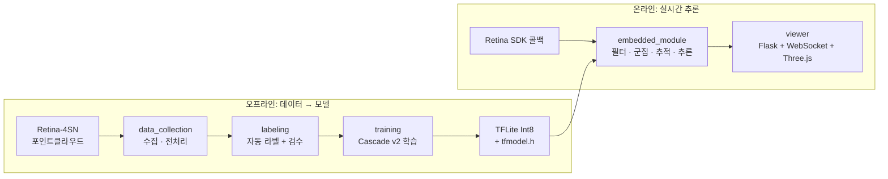

# ra2dar

> **Radar-based human detection system (Capstone Design).** Point clouds from the Retina-4SN 4D imaging radar are collected, preprocessed, auto-labeled, and used to train a cascade model that classifies humans, animals, and clutter in real time on an embedded ARM module.

## 개요

캡스톤디자인으로 진행한 **레이더 기반 감시체계**입니다. 레이더 포인트클라우드만으로 감지된 객체가 **사람인지, 강아지 같은 동물인지**를 구분합니다. 특히 포복·엎드림처럼 **낮은 자세의 사람**이 동물로 오분류되는 문제를 해결하는 데 집중했습니다.


## 핵심 결과

| 지표 | 값 |
|---|---|
| 포복(낮은 자세) 사람 recall | **0.97** (v1 약 0.30 → v2) |
| 강아지 오탐률(FPR) | **0.012** |
| 목표 기준 | 포복 recall ≥ 0.70, 강아지 FPR < 0.10 |

v1 모델은 포복한 사람을 강아지로 분류했습니다. 원인을 분석해 모델이 공간·시간 패턴이 아니라 통계 특징(z 범위 등)만으로 판단하는 **shortcut 학습**을 하고 있다는 것을 찾았고, 메타데이터 차원 축소(11 → 8), z 스케일 증강, 포복 샘플 가중치로 해결했습니다. (Cascade v2, 상세는 `training/` 노트북 참고)

## 시스템 구성



## 폴더 구조

| 폴더 | 내용 |
|---|---|
| `data_collection/` | 레이더 TCP 접속·패킷 파싱, 프레임 저장, 포인트클라우드 전처리 |
| `labeling/` | 규칙 기반 자동 라벨 생성과 시간축 보정, 브라우저 기반 검수 도구 |
| `training/` | Cascade v2 학습·평가 노트북(PyTorch, Colab), TFLite Int8 변환과 C 헤더 생성 |
| `embedded_module/` | 레이더 SDK 위에서 도는 C++ 파이프라인 (Z 필터 → Voxel → SOR → 4D DBSCAN → 추적 → TFLite 추론) |
| `viewer/` | 포인트클라우드와 판별 결과를 보는 웹 뷰어 (WebSocket push + Three.js 렌더링), 라즈베리파이 부팅 시 자동 실행 스크립트 |
| `calibration/` | 카메라 영상과 레이더 좌표의 변환 관계 계산, 동기화·시각화 |

## 담당 역할: 데이터 수집 · 전처리

### 1. 데이터 수집
레이더가 내보내는 데이터를 실시간으로 받아 학습용 데이터셋을 만들었습니다.

- **`radar_client.py`**: 레이더(TCP)에 직접 접속해 패킷을 파싱합니다.
  - 헤더와 패킷 구조(점 하나당 x, y, z, Doppler, Power)를 해석해 프레임 단위로 복원
  - 연결이 끊기면 자동으로 재접속
  - 세 가지 모드 지원: ① 프레임 JSON 저장, ② 즉시 전처리, ③ 모델 입력까지 만들어 콜백으로 전달
- **`radar_recorder.py`**: 프레임마다 JSON을 세션 폴더에 저장합니다.
  - 저장 필드: `T`(시간), `C`(좌표), `V`(속도), `P`(반사 강도), `TID`/`TRK`(트래킹 정보)

### 2. 전처리 (`cluster_process.py`)
노이즈가 많은 포인트클라우드를 학습에 쓸 수 있는 입력으로 바꾸는 파이프라인입니다.

1. **속도(V) 필터**: 정적 반사 제거
2. **반사 강도(P) 필터**: 약한 반사 제거
3. **Z 게이팅(옵션)**: 지면과 천장 영역 제거
4. **Voxel 다운샘플링**: 격자 단위로 점 개수 줄이기
5. **SOR(Statistical Outlier Removal)**: 통계적으로 튀는 점 제거
6. **DBSCAN 군집화**: 점들을 객체 단위로 분리
7. **작은 군집 제거**

모델 입력용으로 한 단계를 더 처리합니다.

8. 군집별 분리 → 정규화(xy 중심 이동, z 바닥 기준, 스케일, V/P 표준화)
9. **FPS(Farthest Point Sampling)로 점 개수를 고정 길이로 통일**

실시간 경로(`radar_client.py` 모드 ③)와 오프라인 경로가 같은 전처리 함수를 쓰도록 만들어, 학습 때와 추론 때 입력이 달라지지 않게 했습니다. 임베디드 모듈의 전처리 단계(Z 필터 → Voxel → SOR → DBSCAN)도 같은 구성을 따릅니다.

## 사용한 기술

| 영역 | 기술 |
|---|---|
| 데이터 처리 | Python, NumPy, Open3D |
| 학습 | PyTorch, TensorBoard, Google Colab |
| 모델 배포 | ONNX → TensorFlow Lite (Int8), TF 2.10, C 배열 헤더 |
| 임베디드 | C++, TFLite C API, ARM 크로스 컴파일 |
| 시각화 | Flask, flask-sock(WebSocket), Three.js |
| 캘리브레이션 | OpenCV, Raspberry Pi(Picamera2) |

## 실행 방법

```bash
# 데이터 수집 (파일 상단의 레이더 IP, 저장 경로 설정 후)
python data_collection/radar_recorder.py

# 라벨링 워크벤치 (데이터셋 zip이 있는 폴더에서)
python labeling/radar_temporal_label_workbench.py --data-dir . --out workbench_outputs

# 라벨 검수
python3 labeling/review_strict.py --zip <dataset>.zip

# 뷰어
pip install flask flask-sock
python viewer/viewer_three.py --retina-host <레이더 IP>   # http://<host>:8050/

# 임베디드 모듈
make TARGET=arm        # ARM 크로스 컴파일 (호스트 데모는 make user_module)
```

모델 학습은 `training/radar_train_colab_cascade_v2.ipynb`를 Colab에서 실행합니다. TFLite 변환은 레이더 SDK가 TF 2.10 기반이라 `tensorflow==2.10.x` 환경에서 해야 합니다. 데이터셋은 저장소에 포함하지 않았습니다.
